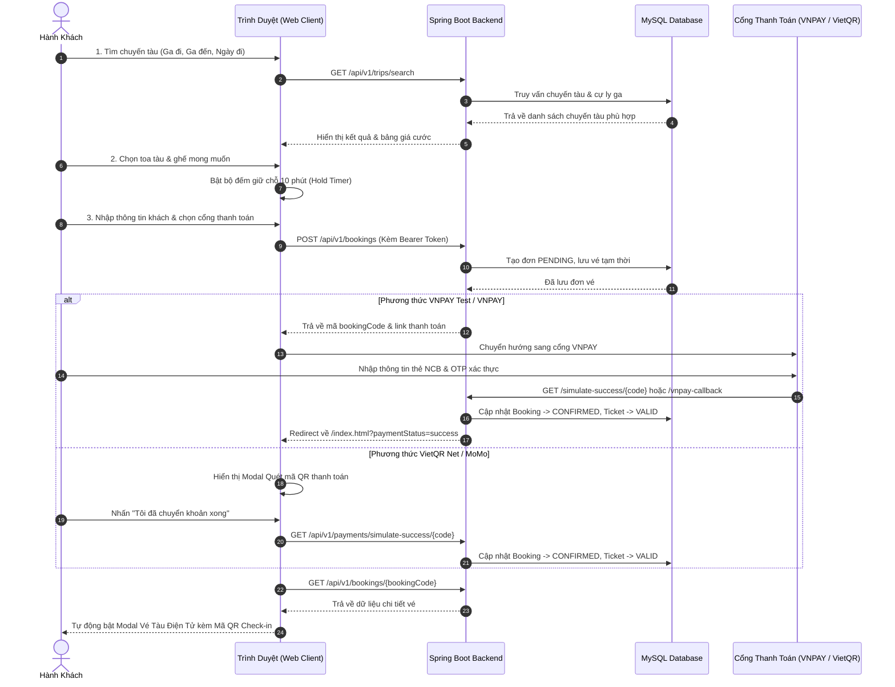

# CHATGPT AND ANTIGRAVITY HÂN HẠNH ĐỒNG HÀNH CÙNG README.MD này
# 🚄 VNR Express - Hệ Thống Đặt Vé Tàu Trực Tuyến & Quản Lý Vận Tải Đường Sắt

[](https://spring.io/projects/spring-boot)
[](https://www.oracle.com/java/)
[](https://www.mysql.com/)
[](LICENSE)
[](http://localhost:8080/swagger-ui.html)

> **VNR Express** là nền tảng thương mại điện tử chuyên biệt phục vụ đặt vé tàu hỏa trực tuyến theo mô hình Tổng Công Ty Đường Sắt Việt Nam (Vietnam Railways). Ứng dụng cung cấp giải pháp toàn diện từ tìm kiếm hành trình liên chặng, chọn chỗ ngồi tương tác trực quan thời gian thực, tính giá động theo cự ly & đối tượng ưu đãi, thanh toán đa kênh (VNPAY / VietQR / MoMo) cho đến xuất vé điện tử tích hợp mã QR Check-in tại ga.

---

## 📑 Mục Lục
- [1. Tính Năng Nổi Bật](#-1-tính-năng-nổi-bật)
- [2. Kiến Trúc & Công Nghệ](#-2-kiến-trúc--công-nghệ)
- [3. Cấu Trúc Thư Mục Dự Án](#-3-cấu-trúc-thư-mục-dự-án)
- [4. Hướng Dẫn Cài Đặt & Khởi Chạy](#-4-hướng-dẫn-cài-đặt--khởi-chạy)
- [5. Tài Khoản & Dữ Liệu Kiểm Thử](#-5-tài-khoản--dữ-liệu-kiểm-thử)
- [6. Quy Trình Nghiệp Vụ (Workflow)](#-6-quy-trình-nghiệp-vụ-workflow)
- [7. Danh Sách API Chính](#-7-danh-sách-api-chính)
- [8. Bản Quyền & Tác Giả](#-8-bản-quyền--tác-giả)

---

## 🌟 1. Tính Năng Nổi Bật

### 🔍 1.1. Tìm kiếm hành trình thông minh
- Tra cứu chuyến tàu theo **Ga đi**, **Ga đến** và **Ngày khởi hành**.
- Tự động hoán đổi chiều hành trình với nút đảo chiều ga nhanh (🔄).
- Hỗ trợ bộ lọc nhanh: Chuyến sáng/chiều/tối, mác tàu tốc hành (SE, TN, HD), loại toa (Ngồi mềm điều hòa, Giường nằm khoang 4, Giường nằm khoang 6).

### 💺 1.2. Sơ đồ ghế tương tác & Cơ chế giữ chỗ (Hold Timer)
- Sơ đồ toa tàu trực quan hiển thị từng vị trí ghế: Ghế trống, ghế đang chọn, ghế đã bán.
- **Cơ chế đếm ngược giữ chỗ (Hold Timer 10 phút)**: Tự động bảo lưu ghế tạm thời trong quá trình điền thông tin, tự động giải phóng nếu quá thời gian thanh toán nhằm chống giữ chỗ ảo (Race condition).
- Cho phép chọn nhiều ghế cùng lúc trên cùng một đơn đặt vé.

### 💰 1.3. Tính giá vé động & Chính sách ưu đãi đối tượng
- Tính giá vé động dựa trên:
  $$\text{Giá vé} = \text{Khoảng cách (km)} \times \text{Đơn giá cơ bản/km} \times \text{Hệ số loại toa} \times \text{Hệ số ưu đãi}$$
- Tích hợp chiết khấu tự động theo đối tượng hành khách:
  - 🎓 **Sinh viên**: Giảm 10%
  - 🧓 **Người cao tuổi (≥ 60 tuổi)**: Giảm 15%
  - 👶 **Trẻ em (6 - 10 tuổi)**: Giảm 50%
  - 👤 **Người lớn (Tiêu chuẩn)**: 100% giá gốc

### 💳 1.4. Thanh toán đa kênh linh hoạt
- **⚡ Cổng VNPAY Sandbox Simulator tích hợp**: Cho phép kiểm thử trọn vẹn luồng thanh toán thẻ ngân hàng nội địa (NCB Sandbox) ngay lập tức mà không bị ảnh hưởng bởi lỗi phê duyệt merchant bên ngoài.
- **🌐 Cổng VNPAY Trực tiếp**: Kết nối chuẩn IPN/Callback với VNPAY Payment Gateway qua mã băm kiểm tra toàn vẹn SHA512.
- **🏦 VietQR Net động**: Tạo mã QR thanh toán ngân hàng (MB Bank) tự động điền sẵn số tiền và mã booking ref.
- **📱 Ví điện tử MoMo**: Quét mã thanh toán ví điện tử nhanh chóng.

### 🎫 1.5. Vé điện tử & Boarding Pass QR Code
- Xuất vé điện tử đạt chuẩn nhận diện thương hiệu VNR Express.
- Tự động sinh **Mã QR Check-in** chuẩn ZXing để kiểm soát vé tự động tại cổng soát vé ga tàu.
- Hỗ trợ in vé điện tử ra khổ giấy A4 hoặc lưu file PDF (`window.print()`).

### 📋 1.6. Quản lý vé & Tra cứu mã đặt chỗ (PNR Lookup)
- Tra cứu nhanh tính hợp lệ của đơn vé theo Mã PNR mà không cần đăng nhập.
- Tab **Vé của tôi**: Xem lịch sử đặt vé, theo dõi trạng thái `CONFIRMED` / `CANCELLED`, in lại vé QR bất kỳ lúc nào.
- Tính năng **Hủy vé**: Tự động hoàn lại chỗ trống cho hành khách khác trên hệ thống.

### 🔐 1.7. Bảo mật & Quản trị phân quyền
- Xác thực Stateless qua **JWT (JSON Web Token)** với cơ chế ký số HMAC-SHA512.
- Phân quyền nghiêm ngặt với Spring Security:
  - `ROLE_USER`: Đặt vé, xem và hủy vé cá nhân.
  - `ROLE_ADMIN`: Toàn quyền quản trị đoàn tàu, ga tàu, tuyến đường, chuyến đi và xem dashboard phân tích.
- Ngăn chặn lỗ hổng IDOR (Insecure Direct Object References) tại tầng Service: Người dùng chỉ được truy xuất dữ liệu đơn vé thuộc quyền sở hữu của chính mình.

### 📊 1.8. Báo cáo & Thống kê doanh thu (Analytics Dashboard)
- Dành riêng cho quản trị viên:
  - Thống kê tổng doanh thu theo tháng / quý.
  - Tỷ lệ lấp đầy ghế trên từng mác tàu.
  - Đếm tổng số đơn vé thành công và tổng số lượt khách phục vụ.

---

## 🛠️ 2. Kiến Trúc & Công Nghệ

```
                                  [ CLIENT BROWSER ]
                         HTML5 / Modern CSS3 / Vanilla JS SPA
                                          │
                                          │ HTTP / RESTful API (JSON)
                                          ▼
                         [ SPRING BOOT 3.3.0 BACKEND ]
  ┌────────────────────────────────────────────────────────────────────────┐
  │  Security Filter Chain (OAuth2 Resource Server + Nimbus JWT Decoder)   │
  ├────────────────────────────────────────────────────────────────────────┤
  │  REST Controllers: Auth, Stations, Routes, Trains, Trips, Bookings,    │
  │                    Payments (VNPAY / QR), Analytics                    │
  ├────────────────────────────────────────────────────────────────────────┤
  │  Service Layer: Transactional Logic, Dynamic Fare Calculator,          │
  │                 Seat Allocation & Ownership Validation                 │
  ├────────────────────────────────────────────────────────────────────────┤
  │  Data Access Layer: Spring Data JPA + Hibernate ORM                    │
  └────────────────────────────────────────────────────────────────────────┘
                                          │
                     ┌────────────────────┴────────────────────┐
                     ▼                                         ▼
            [ MySQL DATABASE ]                      [ VNPAY / EXTERNAL API ]
      Stations, Routes, Trains,                VNPAY Gateway, QR Generator,
      Trips, Seats, Bookings, Tickets                VietQR Network
```

### Chi tiết Stack công nghệ:
| Hạng mục | Công nghệ sử dụng | Phiên bản / Ghi chú |
| :--- | :--- | :--- |
| **Ngôn ngữ** | Java | OpenJDK 21 LTS |
| **Framework chính** | Spring Boot | 3.3.0 |
| **ORM & Database** | Spring Data JPA, Hibernate, MySQL | MySQL 8.x Connector |
| **Bảo mật** | Spring Security 6, Nimbus OAuth2, JJWT | 0.12.5 (HS512) |
| **Xử lý DTO & Mapper** | MapStruct, Lombok | 1.5.5.Final, 1.18.32 |
| **Mã hóa QR** | Google ZXing (Core & JavaSE) | 3.5.4 |
| **Tài liệu API** | SpringDoc OpenAPI (Swagger UI) | 2.5.0 |
| **Testing** | JUnit 5, Mockito, Spring Boot Starter Test | MockMvc, AssertJ |
| **Frontend** | HTML5, CSS3 Variables (Responsive), Vanilla JS | Single Page App |
| **Triển khai** | Docker, Railway CLI | MySQL Container / Railway Cloud |

---

## 📂 3. Cấu Trúc Thư Mục Dự Án

```text
train-ticket-booking/
├── src/
│   ├── main/
│   │   ├── java/com/trainbooking/
│   │   │   ├── config/              # Cấu hình Spring Security, CORS, JWT Decoder, OpenAPI
│   │   │   ├── controller/          # REST Controllers tiếp nhận request từ client
│   │   │   ├── dto/
│   │   │   │   ├── request/         # Data Transfer Objects cho Request Body
│   │   │   │   └── response/        # DTO chuẩn hóa ApiResponse<T>, BookingResponse...
│   │   │   ├── entity/              # JPA Entities (User, Station, Route, Train, Trip, Seat...)
│   │   │   ├── exception/           # GlobalExceptionHandler & ErrorCode xử lý lỗi tập trung
│   │   │   ├── mapper/              # MapStruct Interfaces chuyển đổi Entity <-> DTO
│   │   │   ├── payment/vnpay/       # Cấu hình và dịch vụ sinh URL băm HMAC VNPAY
│   │   │   ├── repository/          # Spring Data JPA Repositories
│   │   │   └── service/             # Interface & Implementation logic nghiệp vụ
│   │   │       └── impl/
│   │   └── resources/
│   │       ├── application.properties # Cấu hình DB, JWT, Port, Cổng thanh toán
│   │       └── static/              # Frontend Single Page Application
│   │           ├── index.html       # Giao diện chính của hệ thống đặt vé
│   │           ├── vnpay-sandbox.html # Giao diện mô phỏng cổng VNPAY Sandbox NCB
│   │           ├── style.css        # Toàn bộ hiệu ứng CSS giao diện hiện đại
│   │           └── app.js           # Xử lý logic phía client (Fetch API, DOM, Seat Map)
│   └── test/
│       └── java/com/trainbooking/   # Unit Test & Integration Test (CheckDatabaseTest...)
├── pom.xml                          # File cấu hình Maven Dependencies & Build Plugins
└── README.md                        # Hướng dẫn chi tiết dự án
```

---

## 🚀 4. Hướng Dẫn Cài Đặt & Khởi Chạy

### 4.1. Yêu cầu môi trường (Prerequisites)
- **Java Development Kit (JDK)**: Phiên bản 21 trở lên.
- **Apache Maven**: Phiên bản 3.9 trở lên (hoặc dùng Maven tích hợp trong IDE).
- **MySQL Server**: Phiên bản 8.0 trở lên (chạy qua Docker hoặc cài trực tiếp).

### 4.2. Chuẩn bị Cơ sở dữ liệu
Tạo cơ sở dữ liệu `ve_tau` trong MySQL:
```sql
CREATE DATABASE IF NOT EXISTS ve_tau CHARACTER SET utf8mb4 COLLATE utf8mb4_unicode_ci;
```

*(Nếu dùng Docker container đã cấu hình sẵn)*:
```powershell
docker run --name mysql-prod -e MYSQL_ROOT_PASSWORD=12345678 -e MYSQL_DATABASE=ve_tau -p 3306:3306 -d mysql:8.0
```

### 4.3. Cấu hình ứng dụng
Mở file `src/main/resources/application.properties` để kiểm tra kết nối:
```properties
spring.datasource.url=jdbc:mysql://localhost:3306/ve_tau?createDatabaseIfNotExist=true&useSSL=false&allowPublicKeyRetrieval=true&serverTimezone=UTC
spring.datasource.username=root
spring.datasource.password=12345678

# Khóa bí mật ký JWT (ít nhất 64 ký tự cho HS512)
jwt.signerKey=1234567890123456789012345678901234567890123456789012345678901234
```

### 4.4. Biên dịch và Khởi chạy

#### Cách 1: Khởi chạy bằng IntelliJ IDEA (Khuyên dùng)
1. Mở thư mục dự án bằng **IntelliJ IDEA**.
2. Chờ Maven tải và đồng bộ các dependency.
3. Mở file `src/main/java/com/trainbooking/TrainTicketBookingApplication.java`.
4. Nhấn nút **Run** (màu xanh lá) hoặc phím tắt `Shift + F10`.

#### Cách 2: Khởi chạy bằng dòng lệnh Terminal
```powershell
# Chạy toàn bộ test suite để kiểm tra tính toàn vẹn
mvn clean test

# Khởi động ứng dụng Spring Boot
mvn spring-boot:run
```

### 4.5. Truy cập hệ thống
- **Giao diện trang chủ (Frontend)**: [http://localhost:8080](http://localhost:8080)
- **Tài liệu Swagger UI (API Docs)**: [http://localhost:8080/swagger-ui.html](http://localhost:8080/swagger-ui.html)
- **OpenAPI JSON Spec**: [http://localhost:8080/v3/api-docs](http://localhost:8080/v3/api-docs)

---

## 👥 5. Tài Khoản & Dữ Liệu Kiểm Thử

### 5.1. Tài khoản đăng nhập hệ thống
| Vai trò (Role) | Username | Password | Quyền hạn |
| :--- | :--- | :--- | :--- |
| **Quản Trị Viên (ADMIN)** | `admin` | `admin123` | Xem Analytics, quản lý toàn bộ hệ thống |
| **Khách Hàng (USER)** | `testuser_payment` | `12345678` | Đặt vé, tra cứu, hủy vé cá nhân |

*(Bạn cũng có thể bấm nút **Đăng Ký** ngay trên giao diện để tạo tài khoản người dùng mới)*.

### 5.2. Thẻ ngân hàng thử nghiệm VNPAY Sandbox (NCB)
- **Số thẻ**: `9704198526191432198`
- **Tên chủ thẻ**: `NGUYEN VAN A`
- **Ngày phát hành**: `07/15`
- **Mã OTP**: `123456`
*(Trang VNPAY Sandbox Simulator đã tích hợp sẵn nút **⚡ Tự động điền** một chạm)*.

---

## 🔄 6. Quy Trình Nghiệp Vụ (Workflow)



---

## 📡 7. Danh Sách API Chính

Hệ thống tuân thủ nghiêm ngặt chuẩn kiến trúc **RESTful API** với định dạng phản hồi chuẩn:
```json
{
  "code": 1000,
  "message": "Thông điệp phản hồi",
  "result": { ... }
}
```

### 7.1. Xác thực & Tài khoản (`/api/v1/auth`)
| Phương thức | Đường dẫn | Phân quyền | Mô tả |
| :--- | :--- | :--- | :--- |
| `POST` | `/api/v1/auth/register` | Public | Đăng ký tài khoản người dùng mới |
| `POST` | `/api/v1/auth/login` | Public | Đăng nhập hệ thống, nhận JWT Token |
| `POST` | `/api/v1/auth/introspect` | Public | Kiểm tra tính hợp lệ của Token |
| `POST` | `/api/v1/auth/refresh` | Public | Gia hạn Token mới |
| `POST` | `/api/v1/auth/logout` | Authenticated | Đăng xuất và vô hiệu hóa Token |

### 7.2. Tra cứu & Chuyến tàu (`/api/v1/trips`, `/api/v1/stations`)
| Phương thức | Đường dẫn | Phân quyền | Mô tả |
| :--- | :--- | :--- | :--- |
| `GET` | `/api/v1/stations` | Public | Lấy danh sách toàn bộ các ga tàu |
| `GET` | `/api/v1/trips/search` | Public | Tìm chuyến tàu theo ga đi, ga đến, ngày khởi hành |
| `GET` | `/api/v1/trips/{id}/seats` | Public | Lấy chi tiết sơ đồ ghế và tình trạng đặt chỗ |

### 7.3. Đặt vé & Thanh toán (`/api/v1/bookings`, `/api/v1/payments`)
| Phương thức | Đường dẫn | Phân quyền | Mô tả |
| :--- | :--- | :--- | :--- |
| `POST` | `/api/v1/bookings` | `USER` / `ADMIN` | Tạo đơn đặt vé mới (hỗ trợ nhiều ghế) |
| `GET` | `/api/v1/bookings` | `USER` / `ADMIN` | Lấy danh sách vé của người dùng đang đăng nhập |
| `GET` | `/api/v1/bookings/{bookingCode}` | `USER` / `ADMIN` | Tra cứu chi tiết đơn vé theo mã PNR |
| `DELETE` | `/api/v1/bookings/{bookingCode}` | `USER` / `ADMIN` | Hủy đơn vé và giải phóng ghế |
| `GET` | `/api/v1/payments/vnpay-pay/{code}` | Public | Tạo link thanh toán VNPAY Redirect |
| `GET` | `/api/v1/payments/vnpay-callback` | Public | Xử lý phản hồi kết quả từ VNPAY |
| `GET` | `/api/v1/payments/simulate-success/{code}` | Public | Cập nhật xác nhận đơn vé (Sandbox mode) |

### 7.4. Phân tích & Báo cáo (`/api/v1/analytics`)
| Phương thức | Đường dẫn | Phân quyền | Mô tả |
| :--- | :--- | :--- | :--- |
| `GET` | `/api/v1/analytics/dashboard` | `ADMIN` | Xem tổng doanh thu, lượt khách, tỷ lệ lấp đầy |
| `GET` | `/api/v1/analytics/monthly-revenue` | `ADMIN` | Thống kê doanh thu theo từng tháng |

---

## 📄 8. Bản Quyền & Tác Giả

Dự án được phát triển phục vụ mục đích học tập, nghiên cứu và làm đồ án tốt nghiệp chuyên ngành Công nghệ thông tin / Kỹ thuật phần mềm.

- **Tác giả**: VNR Development Team
- **Mã nguồn GitHub**: [https://github.com/tcqd30122006Lshe/vnr-express-train-booking](https://github.com/tcqd30122006Lshe/vnr-express-train-booking)
- **Giấy phép**: Phát hành theo giấy phép mã nguồn mở [MIT License](LICENSE).
